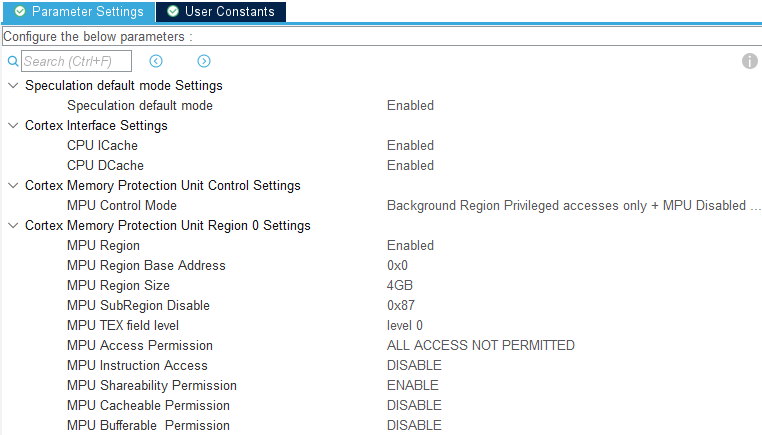
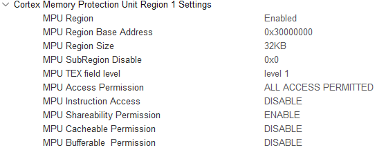
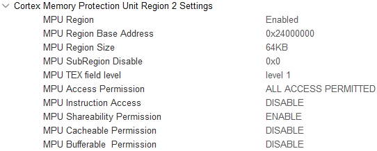

# Memory Layout, MPU, Ethernet and LwIP Setup

How RAM is split on the STM32H723 and why. The D-Cache is enabled, so every buffer a DMA engine touches must live in an MPU non-cacheable region, and DTCM is invisible to the general-purpose DMA controllers.

Sources of truth: `Open-Tube-Light.ioc` (CubeMX: ETH, LwIP, MPU) and `STM32H723XX_FLASH.ld` (hand-maintained).

## Region map

| Region | Address | Size | Cache | Contents |
|---|---|---|---|---|
| `DTCMRAM` | `0x20000000` | 128 KB | n/a (TCM) | `.data`, `.bss`, stack, FreeRTOS heap (15 KB), `.dtcm_dmx` (DMX shadow/active/pending buffers). **CPU-only, no DMA.** |
| `RAM_D1_LWIP` | `0x24000000` | 64 KB | Non-cacheable (MPU region 2) | LwIP heap (32 KB @ `0x24000000`) + ETH RX pool (`.rxpool_sec` @ `0x24008000`). ~98 % full by design. |
| `RAM_D1` | `0x24010000` | 256 KB | Cacheable (default map) | Currently unused. Free for large CPU-only structures. |
| `RAM_D2` | `0x30000000` | 32 KB | Non-cacheable (MPU region 1) | `.d2_dma_nocache`: ETH RX/TX descriptors, `.spi_buffers` (SK9822), `.uart_buffers` (DMX512), `.i2c_buffers` (OLED). |
| `RAM_D3` | `0x38000000` | 16 KB | — | Unused. |

`NOLOAD` sections are not zeroed by the startup code — zero them explicitly during init.

### Ethernet / LwIP buffers

All 32-byte aligned.

| Item | Symbol | Defined in | Address | Size [B] |
|---|---|---|---|---|
| RX descriptors | `DMARxDscrTab` | `ethernetif.c` | `0x30000000` | 480 (20 × 24) |
| TX descriptors | `DMATxDscrTab` | `ethernetif.c` | `0x300001E0` | 96 (4 × 24) |
| RX buffers | `memp_memory_RX_POOL_base` | `ethernetif.c` | `0x24008000` | 20 × (1536 + 32) = 31 360 |
| LwIP heap | `LWIP_RAM_HEAP_POINTER` | `lwipopts.h` | `0x24000000` | 32 768 |

## Linker script (`STM32H723XX_FLASH.ld`)

Changes against the CubeMX default:

1. The first 64 KB of AXI SRAM is split off as `RAM_D1_LWIP` so it can be covered by a single, self-aligned 64 KB MPU region. `RAM_D1` starts at `0x24010000` and is 64 KB shorter.

   ```ld
   RAM_D1_LWIP (xrw) : ORIGIN = 0x24000000, LENGTH = 64K
   RAM_D1      (xrw) : ORIGIN = 0x24010000, LENGTH = 256K
   ```

2. RX pool pinned to the upper half of `RAM_D1_LWIP` (must match *ETH → Rx Buffers Address* in CubeMX):

   ```ld
   .rxpool_sec 0x24008000 (NOLOAD) : {
     . = ALIGN(32);
     KEEP(*(.Rx_PoolSection))
     . = ALIGN(32);
   } >RAM_D1_LWIP
   ```

3. All peripheral DMA buffers collected in D2:

   ```ld
   .d2_dma_nocache (NOLOAD) : {
     . = ALIGN(32);
     KEEP(*(.RxDescripSection))   /* ETH Rx DMA descriptors */
     KEEP(*(.TxDescripSection))   /* ETH Tx DMA descriptors */
     . = ALIGN(32);
     KEEP(*(.spi_buffers))        /* SK9822 SPI DMA buffers */
     KEEP(*(.uart_buffers))       /* DMX512 UART DMA buffers */
     KEEP(*(.i2c_buffers))        /* OLED I2C DMA buffers */
     . = ALIGN(32);
   } >RAM_D2
   ```

4. DMX universe buffers in DTCM (CPU-only, zero wait state):

   ```ld
   .dtcm_dmx (NOLOAD) : {
     . = ALIGN(32);
     KEEP(*(.DMX_Buffers))
     . = ALIGN(32);
   } >DTCMRAM
   ```

5. Link-time `ASSERT`s guard D2 overflow (> 32 KB) and LwIP region overflow (heap + RX pool > 64 KB).

## MPU settings (CubeMX → CORTEX_M7)

### Region 0 — background
4 GB, no access, speculative access disabled for unused address space.



### Region 1 — D2 SRAM
`0x30000000`, 32 KB, TEX level 1, not bufferable, shareable, no execute → non-cacheable for ETH descriptors and peripheral DMA buffers.



### Region 2 — D1 LwIP area
`0x24000000`, 64 KB, TEX level 1, shareable, no execute → non-cacheable LwIP heap and RX pool.



## Ethernet (CubeMX → ETH)

- Mode: RMII, PHY LAN8742A
- TX descriptor count 4 @ `0x300001E0`
- RX descriptor count 20 @ `0x30000000`
- RX buffers @ `0x24008000`, length 1536
- ETH global interrupt enabled
- All ETH GPIO at *Very High* speed
- MAC address: the CubeMX value (`00:80:E1:00:00:00`) is overridden in `ethernetif.c` `USER CODE MACADDRESS` with a per-unit address from `DeviceConfig_GetMacAddress()` (MCU UID hash, `02:xx:xx:xx:xx:xx`)

## LwIP (CubeMX → LWIP)

| Setting | Value | Note |
|---|---|---|
| `LWIP_DHCP` | 0 | Static IP `192.168.1.179/24`, gateway `192.168.1.1` |
| `MEM_SIZE` | 32 × 1024 | |
| `LWIP_RAM_HEAP_POINTER` | `0x24000000` | |
| `ETH_RX_BUFFER_CNT` | 20 | |
| `PBUF_POOL_SIZE` | 24 | |
| `PBUF_POOL_BUFSIZE` | 1536 | |
| `MEMP_NUM_UDP_PCB` | 10 | |
| `TCPIP_THREAD_STACKSIZE` | 2048 | Bytes (passed to `osThreadNew` `stack_size`). Raised from 1024 after a stack overflow; CubeMX incorrectly reports the value in Words |
| `IP_REASSEMBLY` | 0 | Large ICMP (1500 B ping) caused issues with reassembly enabled |
| `IP_FRAG` | 1 | |
| `CHECKSUM_BY_HARDWARE` | 1 | |
